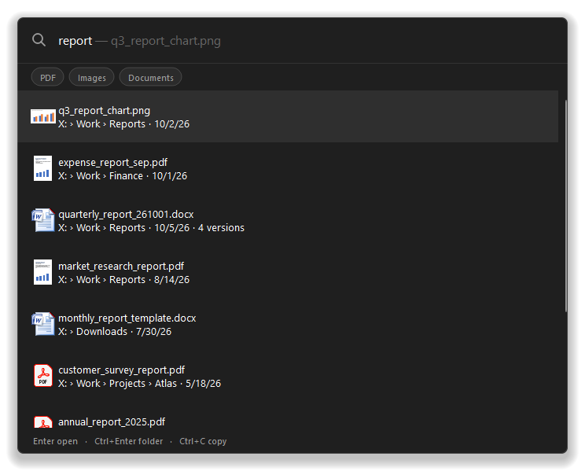
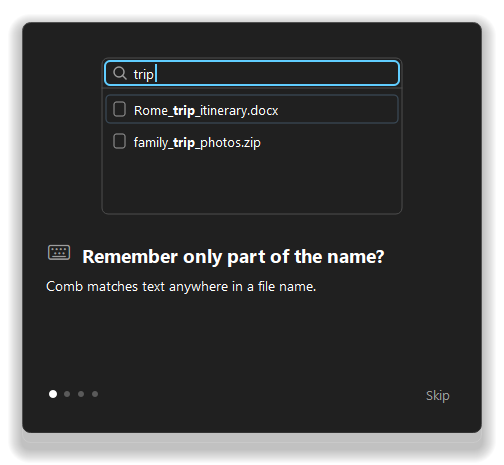
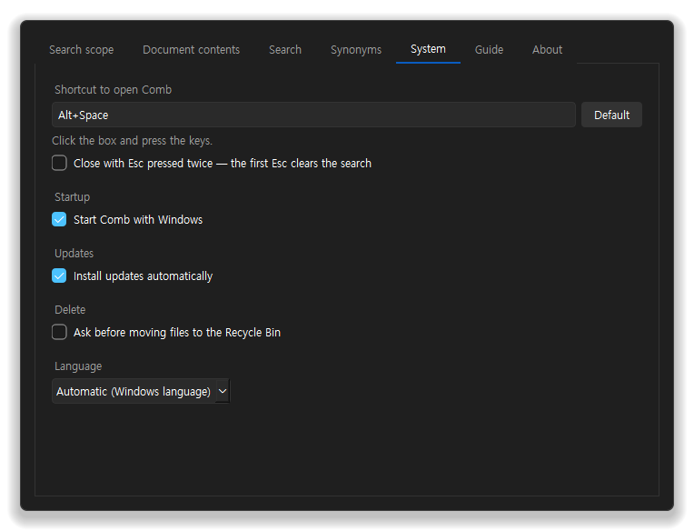
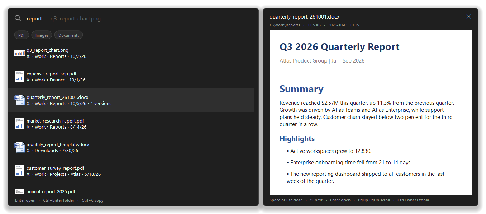
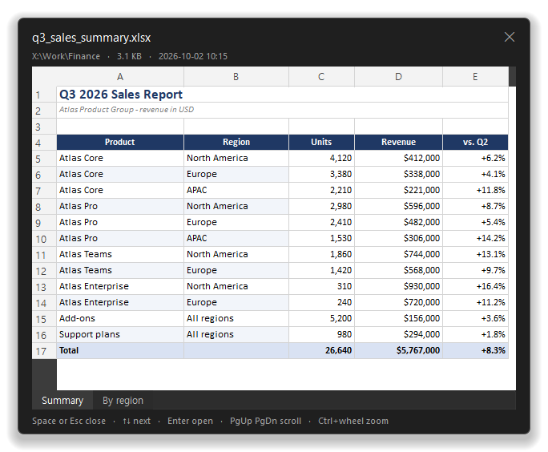
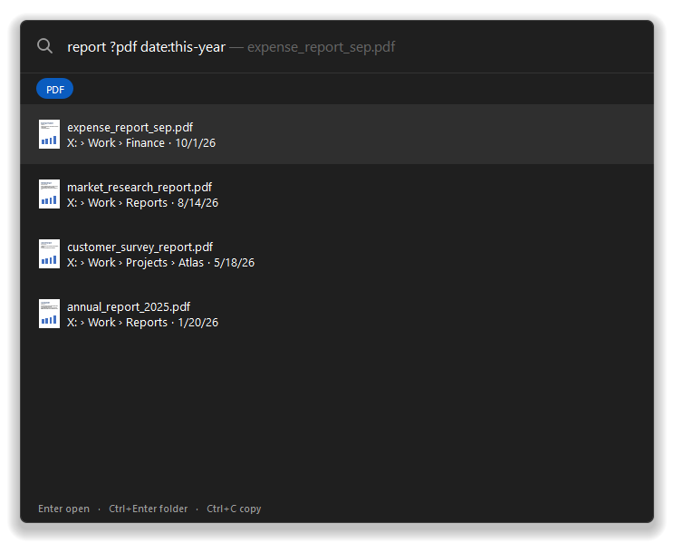
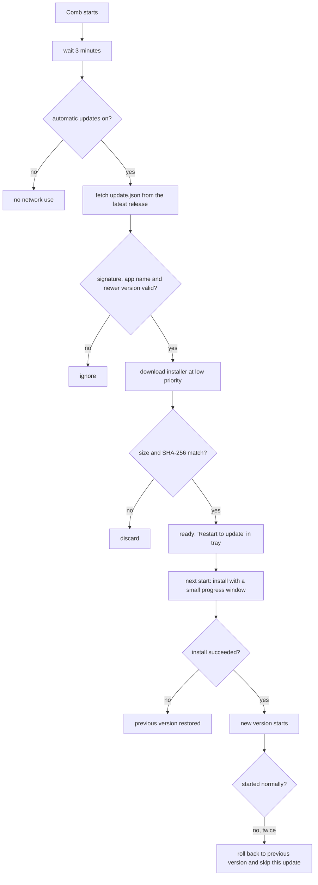
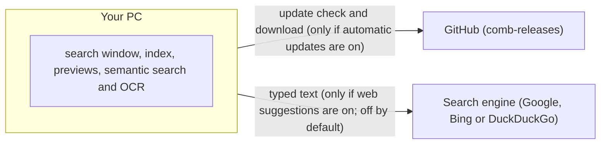

# Comb

Comb is a Windows file search launcher that stays in the system tray and opens instantly with a hotkey.


*The search window: typing "report" lists matching files from several folders; a document with four dated versions is shown as one row.*

This is the release repository for Comb.

This repository holds only Comb's release files: the Windows installer (`Comb-Setup-<version>.exe`) and a signed `update.json` for each release. It does not contain source code.

## Overview

Comb provides file name and content search (including PDF, Office documents, and text) with low resource usage. It can also open Windows applications and settings.

## Why Comb

- **Matches any part of a file name**, not only the beginning of words. For example, "port" finds quarterly_report.docx. (The built-in Windows search matches from the beginning of words.)
- **Instantly search files by name and content.**
- **Searches the drives you choose** on first run — all local drives and cloud folders such as OneDrive or Google Drive are selected by default — not just your user folder.
- **Results are your files only.** Web search is a separate row you choose explicitly; web results are never mixed into file results.
- **Preview without opening an app:** press Space (or Ctrl+Y). Supported previews include Word, Excel and PowerPoint files (also older .doc/.xls/.ppt), PDF, images, text and code, Markdown, web pages, email files (.eml/.msg), ZIP archives, fonts, EPUB, Hangul (.hwp/.hwpx), audio and video. Space preview is also available in File Explorer and on the desktop (can be disabled in settings).
- **Act on a result right away:** open its folder, copy the file or its path, rename (F2), move to the Recycle Bin with undo (Ctrl+Z), or drag and drop files directly from the search results into another app.
- **Logical search results order:** files are never ranked newer than a date written in their name; files marked as copies ("Copy of...", "... - Copy", Google Drive copies) go below the originals; the same file in different folders (same name and same size) is shown as one row; files in the same folder whose names differ only by a date (for example report_260101.pdf and report_260201.pdf) are shown as one row with the other versions under it.
- **Stays in the system tray** and opens instantly with Alt+Space. Optional features (semantic search, OCR, browser history, web suggestions) do nothing until you turn them on.
- **Works offline.** Searching, indexing, previews, semantic search and OCR all run on your PC.
- **Open Windows applications and settings.**
- **Web search integration and clipboard history search** (clipboard history is disabled by default).
- **Browser bookmarks and history search** (optional, disabled by default; read locally from the browser's files).
- **Clean up window:** accessible from the tray menu, this utility finds duplicate files, large files and folders, old files, and older versions of the same document, allowing selected items to be moved to the Recycle Bin.

## Download

Download `Comb-Setup-<version>.exe` from the [Releases](https://github.com/luisdonginseo/comb-releases/releases) page.
The latest release can always be found here: [Latest Release](https://github.com/luisdonginseo/comb-releases/releases/latest)

## System Requirements

- Windows 10 version 1809 or later, or Windows 11 (64-bit / x64).

## Installation

Comb installs per-user to `%LOCALAPPDATA%\Programs\Comb` and does not require administrator rights. The installer presents the Terms of Use for agreement and offers an optional desktop shortcut. On its first run, Comb will prompt whether it should start automatically with Windows.


*A first-run guide card.*

**Note on Windows SmartScreen**: The installer is not currently code-signed. During the first manual installation, Windows SmartScreen may display a "Windows protected your PC" warning. To continue, select "More info" and then "Run anyway". Automatic updates do not trigger this warning.


*Settings, System tab: shortcut, start with Windows, "Install updates automatically", delete confirmation, language.*

## Getting Started

Press `Alt+Space` (default hotkey) to open Comb.

### Keyboard Shortcuts

| Key | Action |
| --- | --- |
| `Enter` | Open the selected file or application |
| `Ctrl+Enter` | Open the folder containing the file |
| `Ctrl+C` | Copy the selected file |
| `Ctrl+Shift+C` | Copy the file path |
| `Ctrl+D` | Move the file to the Recycle Bin |
| `F2` | Rename the selected file |
| `Ctrl+Shift+Enter` | Run as administrator |
| `Space` or `Ctrl+Y` | Quick Look preview |
| `Shift+Up/Down` or `Ctrl+A` | Select multiple items |
| `Esc` | Close the window |


*The search window with the Quick Look preview of a Word document next to it.*


*Quick Look preview of an Excel spreadsheet (table, totals row, sheet tabs).*

### Search Syntax

| Syntax | Action |
| --- | --- |
| `word` | Search for files containing the word |
| `"exact phrase"` | Search for the exact contiguous phrase |
| `-word` | Exclude files containing the word |
| `?pdf`, `?image`, `?doc`, `?sheet`, `?slide`, `?video`, `?audio`, `?zip` | Filter by file type |
| `date:today`, `date:yesterday`, `date:this-week`, `date:last-week`, `date:this-month`, `date:last-month`, `date:this-year`, `date:last-year`, `date:YYYY-MM-DD` | Filter by modification date |
| `size:>10mb`, `size:<1gb` | Filter by file size (supports b, kb, mb, gb, o, ko, mo, go) |
| `in:Downloads`, `in:Desktop`, `in:Documents`, or arbitrary path names | Filter by folder name |
| `C:\` or `~\` | Navigate directories directly |


*Search syntax in use: "report ?pdf date:this-year" shows only this year's PDFs.*

## Automatic Updates

Comb checks this repository for a new release once, three minutes after starting. It does not check repeatedly. If a newer version is available, it downloads quietly at low priority and installs the next time Comb starts. A minimal progress window appears during installation, followed by an automatic restart. The system tray menu will display "Restart to update" when an update is ready.

The following flowchart illustrates the update process:



- **Configuration**: Automatic updates are enabled by default via the "Install updates automatically" setting. When disabled, Comb makes no network requests for updates. Pre-releases are never installed automatically.
- **Security**: The `update.json` file is signed using ECDSA P-256. The installer's SHA-256 hash is embedded within the signed content. Before installing, Comb verifies the signature, application name, that the version is newer than the installed one, file size, and the hash.
- **Rollback**: If an installation fails to complete, the previous version is restored. If a newly installed version fails to start twice consecutively, Comb reverts to the previous version on the next startup and prevents that specific update from installing again.

## Privacy and Network Use

Comb executes all search, indexing, preview, semantic search, and OCR operations entirely on the local machine. It contains no telemetry or analytics. Browser bookmarks and history are only read locally if the feature is explicitly enabled.

The application only connects to the network in the following circumstances, as outlined below:



1. Update checks and downloads from GitHub, only when automatic updates are on.
2. Web search suggestions while typing (off by default). When enabled, typed text is sent to the selected search engine (Google, Bing, or DuckDuckGo).

Choosing "Search the web" opens the query in the default web browser.

## Data Locations

| Data Type | Path |
| --- | --- |
| Settings and Indexes | `%LOCALAPPDATA%\Comb` |
| Search Index | `%LOCALAPPDATA%\Comb\index\` |
| Downloaded Updates | `%LOCALAPPDATA%\Comb\updates\` |

## Verifying a Download

Each release includes an `update.json` file containing the installer's SHA-256 hash inside its signed `manifest` field. 

To verify a downloaded installer manually, run the following in PowerShell and compare the output with the `sha256` value in `update.json`:
```powershell
Get-FileHash .\Comb-Setup-<version>.exe -Algorithm SHA256
```

## Uninstall

To remove Comb, navigate to **Settings > Apps > Installed apps > Comb > Uninstall**. 

The uninstaller will prompt whether to delete Comb's settings and search index. Choosing "No" retains them for a future installation. The application's "start with Windows" registry entry and any downloaded update files are permanently removed during uninstallation.

## Languages

The user interface is available in English, Korean, German, Japanese, Traditional Chinese, French, Spanish, and Portuguese (Brazil).

## Versioning and Release Notes

Versions are numbered MAJOR.MINOR.PATCH (for example 0.2.0) and release notes are on the [Releases](https://github.com/luisdonginseo/comb-releases/releases) page.

## Support

For inquiries, contact: luis.tjdongin@gmail.com

## License

The software license will be announced prior to the public release. The Terms of Use are presented in the installer and remain accessible within Comb's settings under the "About" tab. Third-party open-source licenses are included with the installed application at **Settings > About > Open-source licenses**.
